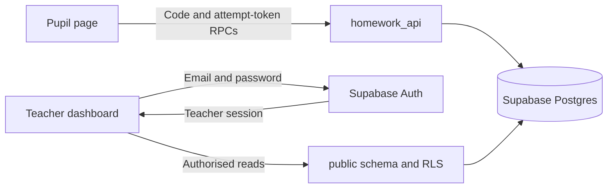

# GCSE History Homework Hub

A plain HTML, CSS and JavaScript homework service for GCSE History. Pupils enter an independent code
to take or resume timed quizzes. Approved teachers sign in to view register numbers, pupil codes and
results for their allocated classes. Only fictional pupil data is approved for this environment.

This repository is the source for both pages and the version-controlled Supabase backend. The
teacher repository is a deployment mirror, not a second source to edit. There is no framework or
application build step.



## Source map

| Path                        | Purpose                                                          |
| --------------------------- | ---------------------------------------------------------------- |
| `pupil/`                    | Pupil `index.html`, `styles.css` and `app.js`                    |
| `teacher/`                  | Teacher `index.html`, `styles.css` and `app.js`                  |
| `shared/`                   | Public configuration and page-scoped colour palettes             |
| `index.html`                | Generated pupil entry for the existing root URL                  |
| `supabase/migrations/`      | Historical baseline and subsequent schema changes                |
| `supabase/seed.sql`         | Fictional fixtures for disposable local development              |
| `supabase/hosted-fixtures/` | Historical environment-specific fixtures; never replay           |
| `supabase/schema-*.json`    | Migration rebuild catalog, grants and original platform metadata |
| `scripts/prepare-pages.py`  | Copies static deployment trees and generates root entries        |
| `tests/r6/`                 | Browser regression checks using fictional mocked responses       |
| `docs/R6.md`                | Consolidation, deployment packaging and prior validation details |
| `AGENTS.md`                 | Short instructions for future coding sessions                    |

## Quiz and teacher flow

1. A pupil submits a code. The server returns available homework, results and unfinished attempts
   for the pupil's class. A direct quiz link uses the same availability rules.
2. Starting or resuming returns an attempt ID and token. Resuming rotates the token while preserving
   progress and the question deadline.
3. The server opens the current question and provides the remaining time and the data needed to
   render it. It marks each answer, records timeouts and calculates the final score.
4. After completing the quiz, the pupil can review their answers and feedback.

Teachers sign in through Supabase Auth. Approved History teachers share the departmental Quiz
Manager library. They can edit drafts, approve them and publish or schedule them for classes.
Teacher approval and class allocation govern access to pupil registers and results. There is no
public registration flow.

## Run locally

For a static preview, use Python 3 from this directory:

```sh
python3 -m http.server 8000 --bind 127.0.0.1
```

Open <http://127.0.0.1:8000/>, `/pupil/` or `/teacher/`. Previewing static files does not create a
local database: `shared/config.js` still targets the hosted LIVE project, and teacher login loads
the pinned local Supabase client. Use the mocked checks below for browser testing without hosted
requests. Do not enter real pupil data.

For development tooling, use Node.js with npm and Python 3. The current browser tests also require
system Chromium at `/usr/bin/chromium` on Linux.

```sh
npm ci
npm run format:check
npm run test:r6
```

`test:r6` covers expired resume/next-question submission, Exit-dialog deadlines, full-quiz
completion, cooldown messages, teacher homework/no-homework rendering, denied/unallocated accounts,
query errors and stale responses after sign-out. Backend requests are intercepted with fictional
responses; external requests are blocked. These tests do not prove hosted RLS, email delivery or
database integrity.

Use `npm run format` for maintained source files. Check root documentation explicitly with
`npx --no-install prettier --check README.md AGENTS.md`.

The historical backend was verified using Supabase CLI 2.81.3 and Docker. A database rebuild is a
separate operation for a disposable local project; it is not required for the mocked browser tests.
Do not reset the hosted project or apply its baseline again. The original R1/backend test tools
remain on `review/r4-pupil-timers`; some expect the pre-consolidation layout and are not commands to
run unchanged here.

## Prepare and release static pages

The public URLs remain:

- Pupil: <https://monob26.github.io/gcse-history-homework-hub/>
- Teacher: <https://monob26.github.io/history-teacher-dashboard/>

Both Pages sites publish `main:/`. Edit source in this repository, then prepare copies:

```sh
python3 scripts/prepare-pages.py pupil work/pupil-pages --enable-quiz-manager
python3 scripts/prepare-pages.py teacher work/teacher-pages --enable-quiz-manager
cp work/pupil-pages/index.html index.html
```

The tracked `pupil/` and `shared/` directories supply the pupil root entry. Copy the prepared
teacher `index.html`, `teacher/` and `shared/` into a review branch of `history-teacher-dashboard`.
Each deployment carries its own shared assets; neither site depends on the other site's asset paths.
Do not hand-edit generated entries or the mirror. Keep the teacher Auth redirect equal to its public
URL. Generate and verify the mirror's deployment files before proposing release:

```sh
python3 tests/r8/mirror.py ../history-teacher-dashboard
```

Use `--environment test --test-config docs/r8/test-config.json` in place of `--enable-quiz-manager`
for the isolated TEST packages. Run `npm run test:db` for the disposable database rebuild and
`npm run test:browser` for the mocked UI regressions.

Review changes and obtain separate owner approval before pushing, merging or publishing. Once
approved, publish the canonical hub first, verify its live files, then publish the teacher mirror
and check sign-in/results/sign-out. Compare public HTML/CSS/JS bytes with the approved files, check
for missing assets and JavaScript errors, and record release evidence in the PRs. Use existing
fictional accounts only. See [R6 deployment notes](docs/R6.md) for packaging and rollback details.

## Page-facing function contract

Send JSON objects to `/rest/v1/rpc/<function>`. Pupil requests use the `homework_api` profile and
public publishable key. Teacher requests use the `public` profile and a signed-in teacher session.
Keep `homework_private` outside the exposed schemas. Never log pupil codes, teacher sessions or
attempt tokens.

### Pupil RPC

`homework_api.quiz_session(action text, payload jsonb)` returns JSON.

| Action   | Payload                         | Result                                                            |
| -------- | ------------------------------- | ----------------------------------------------------------------- |
| `list`   | `code`                          | Code validity, class, year and available quiz summaries           |
| `home`   | `code`, optional `quiz_id`      | One available quiz summary, including timing, progress and status |
| `start`  | `code`, `quiz_id`               | `attempt_id` and rotating `attempt_token`                         |
| `open`   | `attempt_id`, `token`           | Question presentation and its server deadline or remaining time   |
| `answer` | `attempt_id`, `token`, `answer` | Server-marked answer, feedback and progress                       |
| `finish` | `attempt_id`, `token`           | Final score, question count and pass decision                     |
| `review` | `attempt_id`, `token`           | Completed attempt marks and answer feedback                       |

`answer` accepts the format appropriate to the question type and `null` for timeout. Late answers
earn no credit. The pass mark is a correct-answer count. Failed `list`, `home` and `start` lookups
share the address-based budget. A cooldown returns HTTP 429 with `Retry-After`.

The six previous RPCs remain available for the legacy page and rollback path. The active Quiz
Manager page uses `quiz_session` for both managed and earlier quizzes.

### Teacher RPCs

| Function                     | Parameters and result                                                                                                                                                                            |
| ---------------------------- | ------------------------------------------------------------------------------------------------------------------------------------------------------------------------------------------------ |
| `is_history_teacher`         | No arguments. Returns whether the current user is approved.                                                                                                                                      |
| `quiz_manager_write`         | `action`, optional `quiz_id`, `expected_revision`, `payload`. Creates, saves, duplicates, takes offline or deletes quizzes subject to state and revision. Returns a JSON success or refusal.     |
| `quiz_manager_import`        | `payload` containing title, year, topic, week and content. Validates and creates a draft atomically. Returns a JSON success or validation errors.                                                |
| `quiz_manager_validate`      | `content`, `topic`. Returns the JSON array of validation issues.                                                                                                                                 |
| `quiz_manager_release`       | `action`, `quiz_id`, `expected_revision`, `payload`. Approves, publishes now or schedules. Release parameters carry confirmation, classes and UK local times. Returns a JSON success or refusal. |
| `quiz_manager_classes`       | No arguments. Returns class IDs, names and years for the departmental publishing workflow.                                                                                                       |
| `quiz_manager_class_results` | `class_id`, `quiz_id`. Returns register numbers, codes, attempts, scores and status for a class allocated to the signed-in teacher.                                                              |

The dashboard reads Quiz Manager quizzes and allocations under teacher-only RLS. Approval is
required before release, and quizzes lock once a pupil starts. Legacy class-results RPCs remain for
the older teacher view. Pupil pages never read Quiz Manager tables directly.

## Backend and release status

LIVE serves Quiz Manager through the pupil hub and generated teacher dashboard. TEST has separate
Pages sites, a separate Supabase project and fictional fixtures. The two CI jobs rebuild the
database and run mocked browser checks. The Quiz Manager schema migration reproduces objects already
present in hosted TEST and LIVE. Apply it to fresh databases only. The schema snapshot describes the
disposable application rebuild, with baseline platform metadata identified in the export.

[Review 2 verification](docs/R12-R18.md) records candidate changes and remaining release gates. The
owner approved shared editing and publishing by authorised History teachers. Class-result boundaries
and quiz approval requirements still apply.

LIVE database changes, merges and deployment require separate owner authorisation. Review hosted
schema changes individually because hosted migration history predates and differs from the
repository baseline. School and Veritau approval is required before real pupil use.
