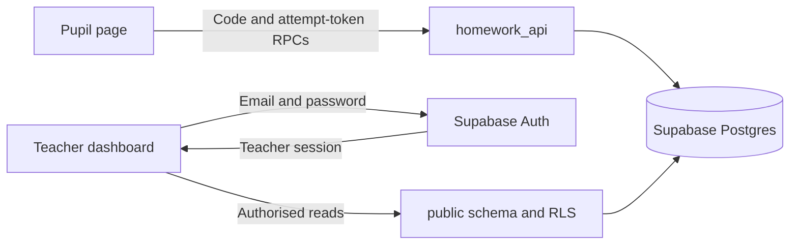

# GCSE History Homework Hub

A plain HTML, CSS and JavaScript homework service for GCSE History. Pupils enter an independent code
to take or resume a timed multiple-choice quiz. Approved teachers sign in to view register numbers,
pupil codes and results for their allocated classes. Only fictional pupil data is approved for this
environment.

This repository is the source for both pages and the version-controlled Supabase backend. The
teacher repository is a deployment mirror, not a second source to edit. There is no framework or
application build step.



## Source map

| Path                        | Purpose                                                          |
| --------------------------- | ---------------------------------------------------------------- |
| `pupil/`                    | Pupil `index.html`, `styles.css` and `app.js`                    |
| `teacher/`                  | Teacher `index.html`, `styles.css` and `app.js`                  |
| `shared/`                   | Public configuration and page-scoped colour palettes             |
| `index.html`                | Generated pupil entry for the existing root URL                  |
| `supabase/migrations/`      | Historical baseline and subsequent schema changes                |
| `supabase/seed.sql`         | Fictional fixtures for disposable local development              |
| `supabase/hosted-fixtures/` | Historical environment-specific fixtures; never replay           |
| `supabase/schema-*.json`    | Historical R1 catalog metadata, not a current hosted export      |
| `scripts/prepare-pages.py`  | Copies static deployment trees and generates root entries        |
| `tests/r6/`                 | Browser regression checks using fictional mocked responses       |
| `docs/R6.md`                | Consolidation, deployment packaging and prior validation details |
| `AGENTS.md`                 | Short instructions for future coding sessions                    |

## Quiz and teacher flow

1. A pupil submits a code to `get_current_pupil_homework`. The response identifies current homework,
   prior results and any unfinished attempt.
2. `start_pupil_quiz` creates or resumes the attempt and returns its ID and token. Resuming rotates
   the token while preserving progress and the question deadline.
3. `open_pupil_question` returns the current question and remaining server time. It does not reveal
   the correct answer. Reopening cannot skip an unanswered question.
4. `submit_pupil_answer` saves one answer, marks it on the server, and returns feedback. Timeout
   submits `null`; the server also enforces the deadline independently.
5. After every question is answered, `complete_pupil_quiz` saves the score and pass decision. The
   page displays the result; unfinished attempts can be resumed later.

Teachers authenticate through Supabase Auth. `is_history_teacher` checks approval; RLS and the
results RPC restrict reads to allocated classes. The page reads published quiz metadata, loads pupil
codes/register numbers and sorts results by register number. There is no public registration flow.

## Run locally

For a static preview, use Python 3 from this directory:

```sh
python3 -m http.server 8000 --bind 127.0.0.1
```

Open <http://127.0.0.1:8000/>, `/pupil/` or `/teacher/`. Previewing static files does not create a
local database: `shared/config.js` still targets the hosted fictional project, and teacher login
loads the pinned CDN library. Use the mocked checks below for browser testing without hosted
requests. Do not enter real pupil data.

For development tooling, use Node.js with npm and Python 3. The current browser tests also require
system Chromium at `/usr/bin/chromium` on Linux.

```sh
npm ci
npm run format:check
npm run test:r6
```

`test:r6` covers expired resume/next-question submission, Exit-dialog deadlines, full-quiz
completion, cooldown messages, teacher homework/no-homework rendering, denied/unallocated accounts,
query errors and stale responses after sign-out. Backend requests are intercepted with fictional
responses; external requests are blocked. These tests do not prove hosted RLS, email delivery or
database integrity.

Use `npm run format` for maintained source files. Check root documentation explicitly with
`npx --no-install prettier --check README.md AGENTS.md`.

The historical backend was verified using Supabase CLI 2.81.3 and Docker. A database rebuild is a
separate operation for a disposable local project; it is not required for the mocked browser tests.
Do not reset the hosted project or apply its baseline again. The original R1/backend test tools
remain on `review/r4-pupil-timers`; some expect the pre-consolidation layout and are not commands to
run unchanged here.

## Prepare and release static pages

The public URLs remain:

- Pupil: <https://monob26.github.io/gcse-history-homework-hub/>
- Teacher: <https://monob26.github.io/history-teacher-dashboard/>

Both Pages sites publish `main:/`. Edit source in this repository, then prepare copies:

```sh
python3 scripts/prepare-pages.py pupil work/pupil-pages
python3 scripts/prepare-pages.py teacher work/teacher-pages
cp work/pupil-pages/index.html index.html
```

The tracked `pupil/` and `shared/` directories supply the pupil root entry. Copy the prepared
teacher `index.html`, `teacher/` and `shared/` into a review branch of `history-teacher-dashboard`.
Each deployment carries its own shared assets; neither site depends on the other site's asset paths.
Do not hand-edit generated entries or the mirror. Keep the teacher Auth redirect equal to its public
URL.

Review changes and obtain separate owner approval before pushing, merging or publishing. Once
approved, publish the canonical hub first, verify its live files, then publish the teacher mirror
and check sign-in/results/sign-out. Compare public HTML/CSS/JS bytes with the approved files, check
for missing assets and JavaScript errors, and record release evidence in the PRs. Use existing
fictional accounts only. See [R6 deployment notes](docs/R6.md) for packaging and rollback details.

## R8 test-isolation preparation

See [R8 isolation notes](docs/R8.md) and the
[final acceptance review](docs/R8-outstanding-review.md). **R8 acceptance is complete:** separate
TEST publication, core flows and genuine emailed recovery passed. Exact Auth URL/redirect/SMTP
settings are owner-verified, not independently API-verified. Documented Free-plan and separate
R2/R11 limitations remain. Live resources are unchanged; draft PR #4 remains unmerged.

Offline checks for the new staging guards: `python3 tests/r8/staging.py`.

## R9 automated regression checks

See [R9 test coverage and status](docs/R9.md). Run `npm run test:db` for a disposable Docker
PostgreSQL rebuild and access/quiz integrity checks, and `npm run test:browser` for the maintained
mocked pupil, teacher and recovery UI checks. These commands use no hosted credentials or data. The
R9 workflow runs both suites on pull requests and pushes to `main`. R9 remains open until its
workflow is observed green on `main`; local passes alone do not meet that final criterion. That
criterion was subsequently met by
[main run 43961631187](https://github.com/monob26/gcse-history-homework-hub/actions/runs/43961631187);
R9 is complete.

## R10 accessibility preparation

See [R10 coverage and release boundaries](docs/R10.md). Keyboard/focus behavior, timing information,
connection recovery, class-ID results and a restrictive CSP are prepared on the R10 branch. The
library is local with its original R5 integrity hash. The new timing and class-ID RPCs require the
reviewed R10 migration **before** frontend publication. TEST migration/publication and hosted
acceptance passed; live migration/publication remains unapproved and PR #6 stays draft.

## Page-facing function contract

This contract carries forward R1's API inventory and incorporates the later checked-in R2/R3
migrations. The historical baseline alone has superseded signatures and grants. Parameters are JSON
object keys sent to `/rest/v1/rpc/<function>`. Pupil calls use `Accept-Profile` and
`Content-Profile: homework_api`, the public publishable key and no teacher login. Teacher calls use
the `public` profile and a signed-in approved teacher session. Table results are arrays; the pupil
client unwraps their first row.

### Pupil RPCs (`anon` role)

- `get_current_pupil_homework(entered_code text)` returns `valid_code boolean`, `class_name text`,
  `year_group integer`, `quiz_id uuid`, `quiz_title text`, `topic text`, `week_number integer`,
  `due_at timestamptz`, `total_questions integer`, `pass_mark integer`, `attempts_taken integer`,
  `highest_score integer`, `passed boolean`, `unfinished_attempt_id uuid`.
- `start_pupil_quiz(entered_code text, entered_quiz_id uuid)` returns `attempt_id uuid`,
  `attempt_token uuid`.
- `open_pupil_question(entered_attempt_id text, entered_attempt_token text)` returns
  `question_number integer`, `question_text text`, `answer_options jsonb`,
  `time_allowed_seconds integer`, `seconds_remaining integer`.
- `submit_pupil_answer(entered_attempt_id text, entered_attempt_token text, entered_answer jsonb)`
  returns `answer_correct boolean`, `correct_option integer`, `feedback text`,
  `next_question integer`.
- `complete_pupil_quiz(entered_attempt_id text, entered_attempt_token text)` returns
  `final_score integer`, `total_questions integer`, `passed boolean`.

The last three wrappers accept UUID strings as text and default missing parameters to `NULL` so
malformed/missing sessions receive a controlled refusal. Answer indexes are zero-based: send JSON
number `0`–`3`, or `null` for timeout. Attempt tokens are credentials: keep them in memory and never
log or commit them. Correct-answer details are returned only by submission, not question opening.
Late answers have no five-second grace period in the current migrations.

Failed homework lookups and starts share a per-observed-address budget: twenty failures trigger a
ten-second cooldown. HTTP 429 includes `Retry-After`; valid pupils sharing that address are also
temporarily blocked. It is a burst/cooldown policy, not a strict per-ten-minute quota. Active
attempt RPCs and teacher Auth use different paths.

### Teacher RPCs (`authenticated` role)

- `is_history_teacher()` returns a boolean indicating whether the current user is an approved
  teacher.
- `get_history_class_results(requested_class text, requested_quiz uuid)` (existing deployed API)
  returns `pupil_code text`, `register_number integer`, `attempts bigint`, `highest_score integer`,
  `homework_status text`, subject to approval and allocation.

The prepared R10 page instead calls
`get_history_class_results_by_id(requested_class_id uuid, requested_quiz uuid)` with the same return
fields. Pupil timing instructions additionally call
`get_pupil_quiz_timing(entered_code text, entered_quiz_id uuid)`, returning a `time_limits` array of
`seconds` and `questions` counts for the pupil's current published quiz. These new functions require
the R10 migration; they are not yet deployed.

The teacher page additionally selects permitted rows from `history_classes`, `history_quizzes` and
`history_pupils`. Neither page directly reads answer tables. `homework_private` contains
implementation helpers and must remain unexposed. The legacy `check_pupil_code` was removed by R2;
it is not part of the current API.

The database treats `pass_mark` as a correct-answer count, not a percentage. The current pupil
presentation still interprets it as a percentage; this existing discrepancy is not changed or
resolved by R7. Use the server's `passed` result as authoritative.

## Backend and release status

R3–R6 are published and their release acceptance passed on 15 November 2026; evidence is recorded in
the [hub R6 PR](https://github.com/monob26/gcse-history-homework-hub/pull/2) and
[teacher R6 PR](https://github.com/monob26/history-teacher-dashboard/pull/3). The R6 document's
pre-publication section is historical evidence. Disabled leaked-password protection and deferred
T13/T14 checks remain separate R2/R11 limitations; this is not approval for real pupil data.

No secret keys in the repository. Only the public publishable key belongs in browser configuration.
Obtain separate approval for Supabase changes, code/token rotation, fixture creation or cleanup.
Keep schema changes as reviewed migrations. Local R2/R3 filenames differ from their hosted
migration-history versions, and the baseline predates that history: never run blanket
`supabase db push` or migration-history repair without a reviewed, separately approved plan. Hosted
fixtures are not replayable seeds.
